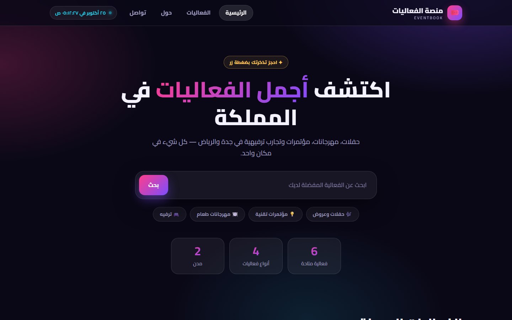
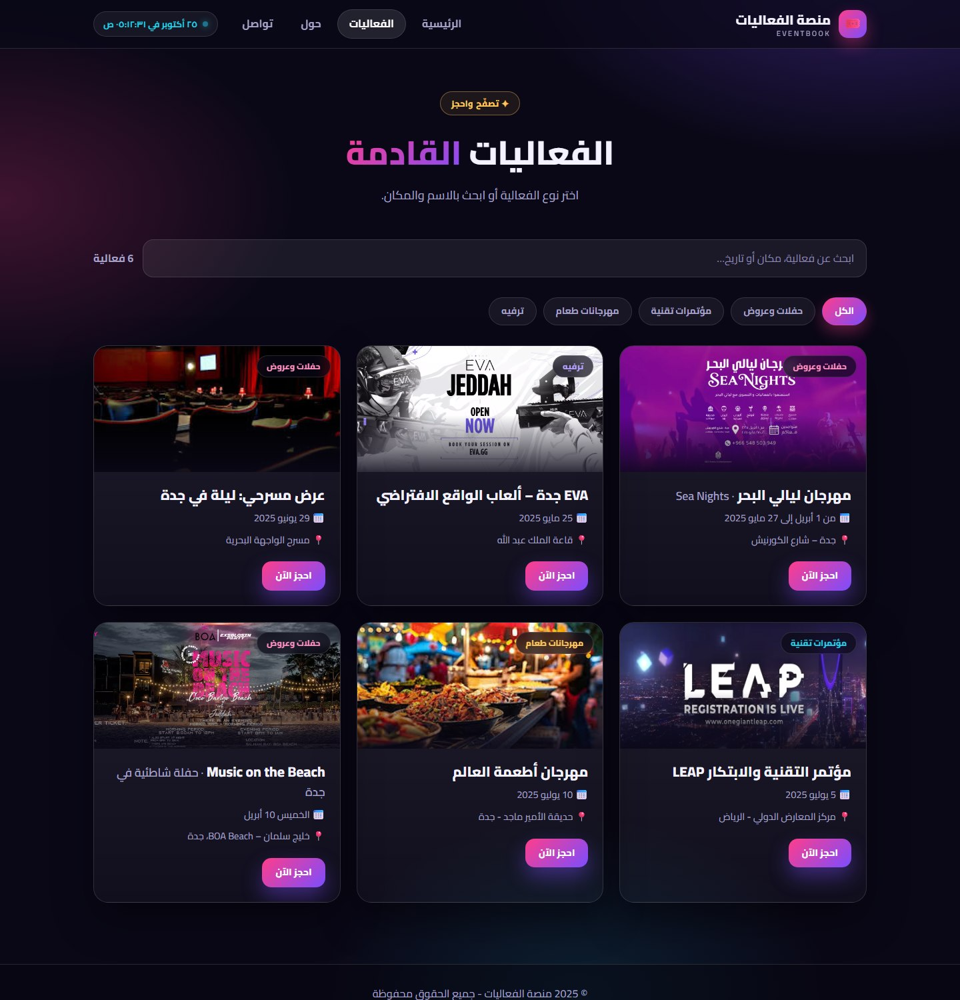
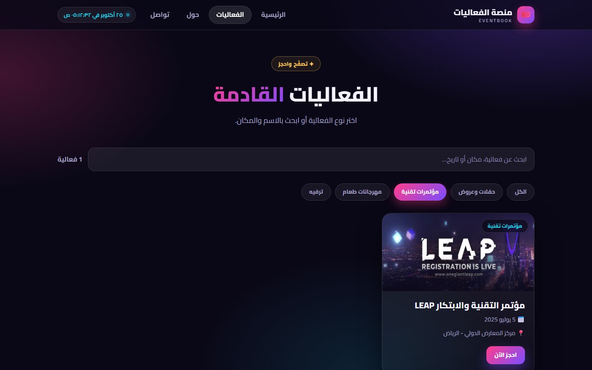
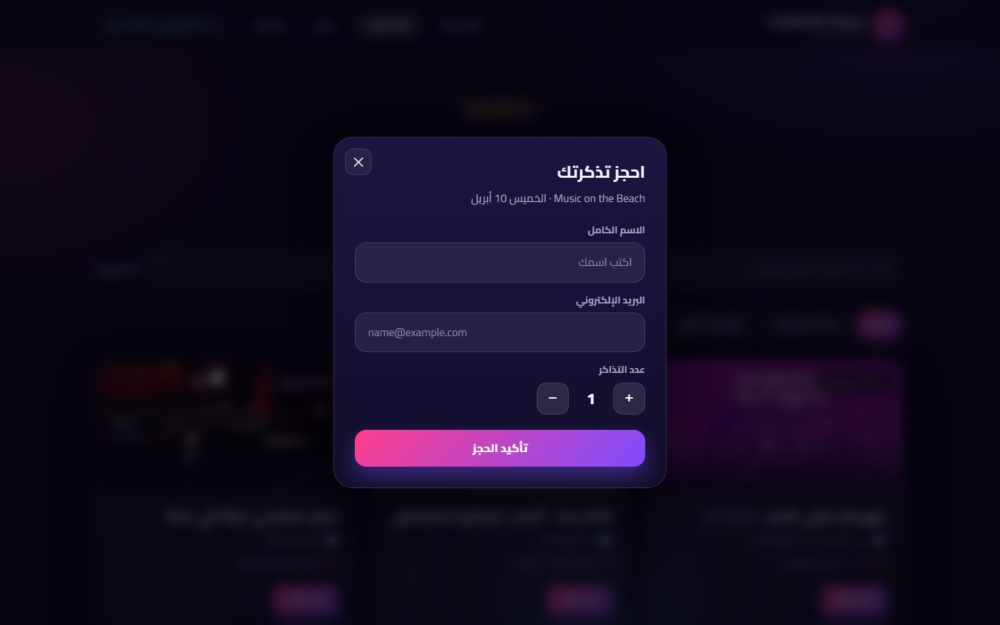
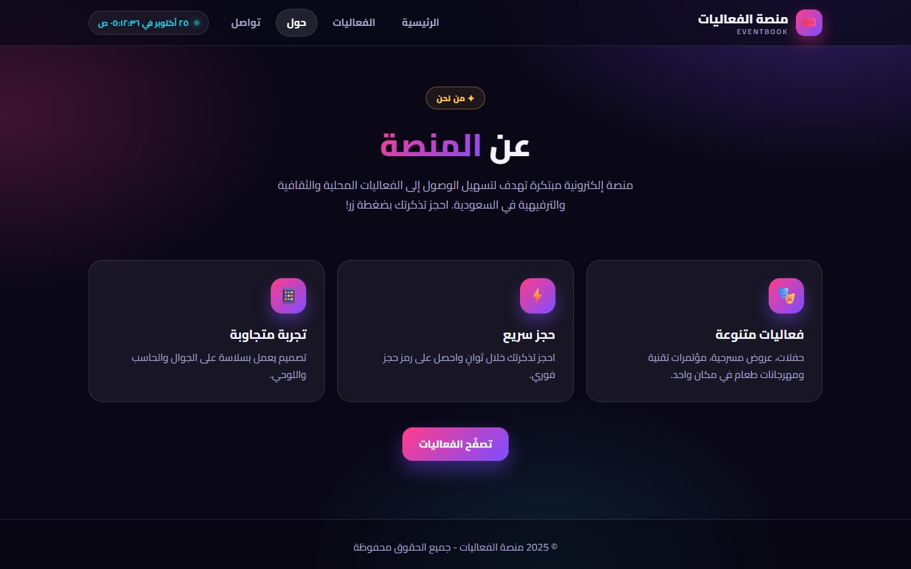
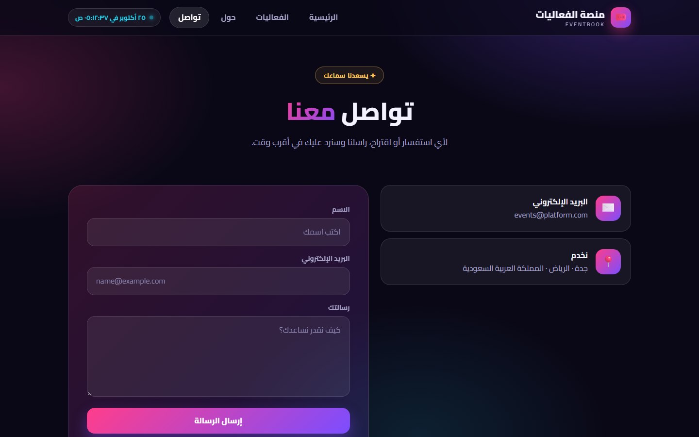
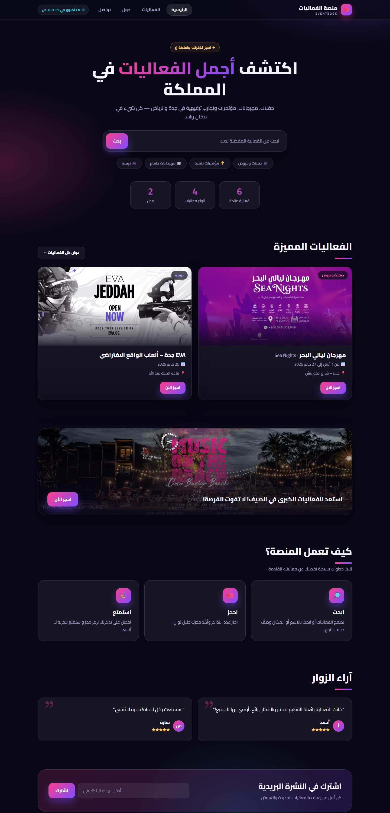
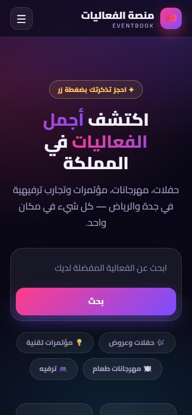
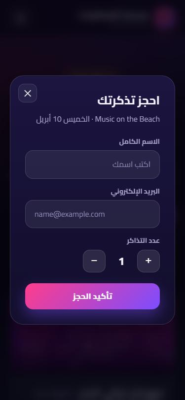
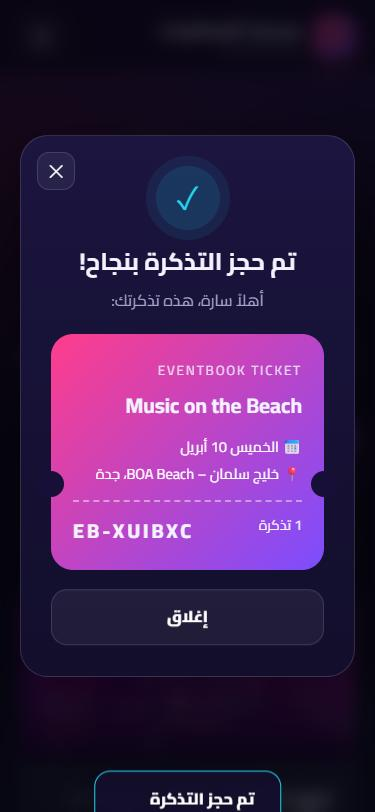

<div align="center">

# 🎟️ منصة الفعاليات · EventBook

**Discover and book the best events in Saudi Arabia — concerts, festivals, conferences and experiences.**

[**▶ Live demo**](https://ritalalghates.github.io/Events-platform/) · Arabic (RTL) · Responsive · No build step




</div>

## ✨ Features

- **Modern dark design** with glass surfaces, gradient accents, the Cairo Arabic font and smooth scroll-reveal animations
- **Live search** by name, venue or date, plus **category filters** (concerts & shows, tech conferences, food festivals, entertainment)
- **Booking flow** – choose the number of tickets, confirm, and get a ticket with a booking code
  (bookings are saved in the browser's `localStorage`)
- **Deep links** – `events.html?cat=tech`, `events.html?q=جدة`, `events.html?book=beach`
- **Hero search** on the home page that jumps to the filtered events list
- **Live clock** in the header (Arabic locale)
- **Fully responsive** – mobile menu, flexible grids, tested down to 375 px
- **Accessible basics** – semantic landmarks, ARIA labels, keyboard support (Esc closes the dialog), reduced-motion support
- **Zero dependencies** – plain HTML, CSS and JavaScript

## 🖼️ Screens

<table>
  <tr>
    <td width="50%"><b>Events with filters</b><br></td>
    <td width="50%"><b>Category filter (tech conferences)</b><br></td>
  </tr>
  <tr>
    <td><b>Booking dialog</b><br></td>
    <td><b>About</b><br></td>
  </tr>
  <tr>
    <td colspan="2"><b>Contact</b><br></td>
  </tr>
</table>

### Home page (full)

<p align="center"></p>

### 📱 On mobile

<p align="center">
  
  
  
</p>

## 🚀 Run it

No installation needed. Open `index.html` in a browser, or serve the folder:

```bash
python -m http.server 8000     # then open http://localhost:8000
```

## 🗂️ Project structure

```text
index.html      Home: hero + search, featured events, banner, how it works, reviews, newsletter
events.html     Events list with search and category filters
about.html      About the platform
contact.html    Contact details and message form (opens your e-mail app)
styles.css      Design system: colours, layout, components, animations
script.js       Events data, rendering, search / filters, booking dialog, toast, clock, menu
images/         Event posters
docs/           README screenshots
```

### Adding or editing events

All events live in the `EVENTS` array at the top of [`script.js`](script.js):

```js
{
  id: "leap",                       // used by ?book=<id>
  city: "الرياض",
  title: "مؤتمر التقنية والابتكار LEAP",
  cat: "tech",                      // music | tech | food | fun
  date: "5 يوليو 2025",
  venue: "مركز المعارض الدولي - الرياض",
  img: "images/leap.png",
  featured: false                   // true = shown on the home page
}
```

## ℹ️ Notes

- This is a front-end demo: there is **no server**. Bookings are stored locally in your browser, the newsletter
  form is a demo, and the contact form opens your e-mail client with a ready-made message to `events@platform.com`.
- Event posters are used for demonstration purposes.
